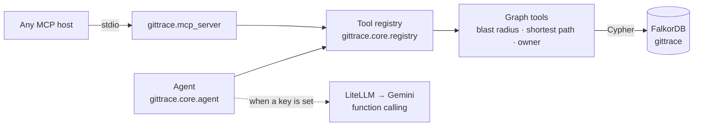

# GitTrace

**Turn a CVE alert into the blast radius, the shortest attack path, and the code owner — by traversing a service dependency graph in FalkorDB.**

[](https://github.com/codingwinterz/GitTrace/actions/workflows/tests.yml)


**Hackathon:** Graph Hacks — Track 01 (Agents That Act on Connected Data) · **Team:** SUDO SAIYAN (Avaneesh S, solo) · Team code `5S3M9E`
**Demo video:** [GIT TRACE's Working & Explanation](https://youtu.be/xwo16Zesdus) (3 min)

[](https://youtu.be/xwo16Zesdus)

> **This branch (`v2`) is being rebuilt as a command-line scanner** — see `CLAUDE.md` for the plan. The web UI and HTTP API shown in the demo video have been removed here (they remain on `main`). The graph tools are available through the MCP server and the `gittrace` Python package.

---

## The question it answers

A scanner reports `CVE-2026-4421` in `validate_token`. Three things decide what you do next:

1. **What is in the blast radius?** Which functions call into the vulnerable code, directly or transitively, and which services are they in?
2. **How does an attacker actually get there?** Which public entry point reaches it, and through what path?
3. **Who do you wake up?** Who owns the affected code?

GitTrace answers all three from one graph, and returns the query that produced each answer.

## See it work

Every value below is asserted by the integration suite (`tests/test_integration.py`), which runs the queries unmocked against a real FalkorDB seeded by `gittrace.graph.seed`, in CI on every push:

| Question | Answer returned |
|---|---|
| Blast radius of `CVE-2026-4421` | `CRITICAL`, affects `/token-service/token.py::validate_token`; 1 service (`token-service`), upstream callers `refresh_token`, `rotate_key` (not `parse_claims`, which it calls) |
| Shortest path `api-gateway` → `validate_token` (scoped by the CVE) | `Service:api-gateway → Service:token-service → File:/token-service/token.py → Function:validate_token`, **3 hops** |
| Owner of `validate_token` (scoped by the CVE) | Sarah Chen · `sarah.chen@acme.com` · `@sarahc`, file `/token-service/token.py` (also owns `auth-service`, `token-service`) |
| Shortest path to `validate_token` with no CVE or file | Error: defined in 2 files, candidates `/auth-service/auth.go::validate_token`, `/token-service/token.py::validate_token` |

---

## Why FalkorDB is load-bearing

The answer *is* a path and a neighbourhood. A vector index can say which code chunks are semantically close to "authentication token"; it has no notion of an edge, so it cannot say that `validate_token` is three hops from a public gateway, or which functions a `CALLS` chain reaches.

Two native capabilities do all the work:

- **Variable-length traversal** — `(caller)-[:CALLS*1..5]->(f)` walks the call graph upstream from the vulnerable function to every caller that would break or carry the attack.
- **`shortestPath()`** — resolves the exact route across five different relationship types (`CONTAINS`, `DEFINES`, `CALLS`, `DEPENDS_ON`, `EXPOSES`) in a single query.

Remove FalkorDB and the product still starts, but it can no longer answer any of the three questions — which is the test for "graph is essential" rather than decoration.

## Architecture



| Package | Contents |
|---|---|
| `gittrace/core` | The three graph tools, the tool registry, question parsing and the agent loop; file discovery and the ingestion pipeline. No web framework. |
| `gittrace/graph` | FalkorDB connection, the demo-graph seed, and `store` (writes a scanned project to its own graph) |
| `gittrace/languages` | Language plug-in interface (`base`) and the Python plug-in: tree-sitter parser, call resolver, FastAPI/Flask route detector |
| `gittrace/mcp_server.py` | MCP server generated from the tool registry |
| `gittrace/rules`, `llm`, `cli` | Empty placeholders for the CLI scanner (later phases) |

The agent (`gittrace.core.agent`) has two execution paths over the same tools:

1. **LLM function calling** — Gemini picks a tool, the agent runs the Cypher, the model writes the answer.
2. **Deterministic classifier** — if no key is configured or the model fails, keyword heuristics call the same tools. Only the prose changes.

---

## Quick start

```bash
git clone https://github.com/codingwinterz/GitTrace && cd GitTrace
cp .env.example .env          # fill in FalkorDB host/port/user/password
python -m venv .venv && source .venv/bin/activate   # Windows: .venv\Scripts\activate
pip install -r requirements.txt
python -m gittrace.graph.seed # one-time: create the gittrace graph
python -m gittrace.mcp_server # MCP server on stdio
```

Run the commands from the repository root. For a local FalkorDB instead of the cloud, `docker compose up -d falkordb` and set `FALKORDB_HOST=localhost`, `FALKORDB_PORT=6379` and an empty `FALKORDB_PASSWORD`.

### Environment

| Variable | Required | Purpose |
|---|---|---|
| `FALKORDB_HOST` / `FALKORDB_PORT` | yes | FalkorDB instance (cloud: **Connectivity → Connect**) |
| `FALKORDB_USER` / `FALKORDB_PASSWORD` | cloud only | Instance credentials |
| `GITTRACE_GRAPH` | no | Graph name (default `gittrace`) |
| `Gemini_API_Key` | no | Enables the agent's LLM function-calling path |
| `LITELLM_MODEL` | no | Model for the agent, e.g. `gemini/gemini-flash-lite-latest` |

`.env` is gitignored.

---

## Graph data model

The seeded graph is a small but complete microservice estate: **7 services, 7 files, 23 functions, 4 developers, 2 CVEs, 5 API endpoints, 75 edges**.

| Node | Properties |
|---|---|
| `(:Service)` | `name, language, port, is_public` |
| `(:File)` | `path` |
| `(:Function)` | `name, line_number, is_entry_point` |
| `(:Developer)` | `name, email, slack_handle` |
| `(:CVE)` | `id, severity, description` |
| `(:APIEndpoint)` | `path, method` |

| Edge | From → To | Meaning |
|---|---|---|
| `CONTAINS` | Service → File | Service ships this file |
| `DEFINES` | File → Function | File defines this function |
| `CALLS` | Function → Function | Function calls another function |
| `DEPENDS_ON` | Service → Service | Service calls another service |
| `OWNS` | Developer → Service | Developer owns this service |
| `AUTHORED` | Developer → File | Developer wrote this file |
| `AFFECTS` | CVE → Function | CVE affects this function |
| `EXPOSES` | APIEndpoint → Function | Endpoint reaches this function |

## Scanning a Python project (ingestion)

The CLI scanner's first stage reads a real project into its own FalkorDB graph. Until `gittrace scan` exists, a temporary entry point runs it:

```bash
python -m gittrace.ingest path/to/project            # writes graph gittrace_<folder>_<hash>
python -m gittrace.ingest path/to/project --dry-run  # parse and resolve only, no database
```

It prints counts of files, parse failures, functions, endpoints, and calls (resolved to project code vs. unresolved, by origin).

- **Files:** every `.py` file except `.git`, virtualenvs (`venv`, `.venv`, or any directory with a `pyvenv.cfg`), `node_modules`, `__pycache__`, `site-packages`, `build`, `dist`, tool caches, and whatever the project's `.gitignore` files exclude. A file with a syntax error is logged, counted and skipped.
- **Functions:** module-level functions, methods and nested functions, with IDs like `app/db.py::Repo.get_user` and `app/db.py::Repo.delete_user.build_query`, their line span (decorators included) and source. Code that runs at import time (module-level calls, decorators, default arguments) belongs to a `path.py::<module>` node.
- **Calls, best effort:** same-file functions, nested functions, `import x [as z]`, `from x import y [as z]`, relative imports, re-exports from a package `__init__`, star imports, `self.m()` / `cls.m()` / `super().m()` through project base classes, and variables assigned once from a project class (`repo = Repo(); repo.get()`). Everything else is kept as an unresolved node named by its full dotted name with aliases expanded (`sp.run` → `external::subprocess.run`, `cursor.execute` → `external::cursor.execute`). Those are the sink candidates. Return values, attributes (`self.db.execute`) and parameters are not type-inferred.
- **Routes:** FastAPI (`@app.get/post/...`, `api_route`, `websocket`, `APIRouter`, `include_router` prefixes, nested routers, sub-apps attached with `app.mount("/api/v1", api)`) and Flask (`@app.route(methods=...)`, `@bp.get/...`, `Blueprint(url_prefix=...)`, `register_blueprint(url_prefix=...)`). A decorator counts only when its object resolves to a `FastAPI`/`APIRouter`/`Flask`/`Blueprint` instance. Literal prefixes only; a router that is never included, or a prefix built from a variable, gives `prefix_resolved: false`. `auth_required` is true only with obvious evidence, recorded in `auth_evidence`: an auth-named `Depends(...)` (directly, or through an alias like `CurrentUser = Annotated[User, Depends(get_current_user)]`), any `Security(...)`, or a decorator such as `@login_required`.
- **Graph:** one graph per project. Every node and edge is written with `MERGE` on its stable ID and stamped with the scan; whatever an older scan wrote and this one did not is deleted, so re-scanning is idempotent and removes stale code. Indexes on `Function.id`, `File.path`, `Endpoint.id`.

| Node | Key properties |
|---|---|
| `(:Project)` | `id` (graph name), `name`, `root`, `scanned_at`, counts |
| `(:File)` | `path`, `language`, `sha256`, `lines` |
| `(:Function {resolved: true})` | `id`, `name`, `qualified_name`, `file`, `kind` (`function`/`method`/`nested`/`module`), `start_line`, `end_line`, `source`, `is_async` |
| `(:Function {resolved: false})` | `id` = `external::<dotted>`, `qualified_name`, `origin` (`builtin`/`import`/`project`/`unknown`) |
| `(:Endpoint)` | `id`, `framework`, `method`, `path`, `handler`, `line`, `auth_required`, `auth_evidence`, `prefix_resolved` |

Edges: `(File)-[:DECLARES]->(Function|Endpoint)`, `(Endpoint)-[:HANDLED_BY]->(Function)`, `(Function)-[:CALLS {lines}]->(Function)`.

The demo graph and the three tools below still use the older demo schema; the scanner replaces them in a later phase.

## The three tools

### Blast radius — `get_blast_radius(cve_id)`

```cypher
MATCH (c:CVE {id: $cve_id})-[:AFFECTS]->(f:Function)<-[:DEFINES]-(file:File)
OPTIONAL MATCH (caller:Function)-[:CALLS*1..5]->(f)
WHERE caller <> f
OPTIONAL MATCH (caller)<-[:DEFINES]-(caller_file:File)
OPTIONAL MATCH (caller_file)<-[:CONTAINS]-(s:Service)
RETURN
    c.id AS cve_id,
    c.severity AS severity,
    collect(DISTINCT s.name) AS impacted_services,
    collect(DISTINCT caller.name) AS impacted_functions,
    count(DISTINCT s) AS service_count,
    collect(DISTINCT file.path + '::' + f.name) AS affected_function_ids,
    collect(DISTINCT caller_file.path + '::' + caller.name) AS impacted_function_ids
```

### Shortest attack path — `find_shortest_dependency_path(start_service, target_function, *, cve_id=None, target_file_path=None)`

```cypher
MATCH (c:CVE {id: $cve_id})-[:AFFECTS]->(f:Function)
MATCH (s:Service {name: $start_service, is_public: true})
WITH s, f, shortestPath((s)-[:CONTAINS|DEFINES|DEPENDS_ON*1..10]->(f)) AS p
RETURN
    [n IN nodes(p) | labels(n)[0] + ':' + coalesce(n.name, n.path, n.id)] AS path_trace,
    length(p) AS hop_count
ORDER BY hop_count ASC, path_trace ASC
LIMIT 1
```

Without `cve_id` or `target_file_path`, the name must be defined in exactly one file; otherwise the tool returns an error listing the candidates (`file_path::name`).

### Code owner — `find_code_owner(function_name, *, file_path=None, cve_id=None)`

```cypher
MATCH (:CVE {id: $cve_id})-[:AFFECTS]->(f:Function)<-[:DEFINES]-(file:File)
// or, by file:  MATCH (file:File {path: $file_path})-[:DEFINES]->(f:Function {name: $function_name})
// or, by name:  MATCH (file:File)-[:DEFINES]->(f:Function {name: $function_name})
OPTIONAL MATCH (file)<-[:AUTHORED]-(dev:Developer)
OPTIONAL MATCH (dev)-[:OWNS]->(s:Service)
RETURN
    file.path AS file_path,
    f.name AS function_name,
    dev.name AS developer_name,
    dev.email AS email,
    dev.slack_handle AS slack,
    collect(DISTINCT s.name) AS owned_services
ORDER BY file_path, function_name, developer_name
```

Every row is checked: if the function resolves to more than one file, the tool reports the ambiguity instead of picking one.

All tools are declared once, in `TOOL_REGISTRY` in `gittrace/core/registry.py`. `tool_schemas()` returns them as OpenAI-format schemas, so any model can call them, and the MCP server is generated from the same registry.

## MCP server (Track 01)

```bash
python -m gittrace.mcp_server      # stdio transport, from the repository root
```

```json
{
  "command": "python",
  "args": ["-m", "gittrace.mcp_server"],
  "env": { "PYTHONPATH": "/path/to/GitTrace" }
}
```

Exposes `get_blast_radius_tool`, `find_shortest_dependency_path_tool`, `find_code_owner_tool` over the Model Context Protocol, so Claude Desktop or any MCP host can query the same graph.

---

## Tests

```bash
python -m pytest tests/test_core.py tests/test_ingest.py -q   # no DB, no API key

docker compose up -d falkordb              # real FalkorDB for the integration suites
FALKORDB_HOST=localhost FALKORDB_PORT=6379 FALKORDB_PASSWORD= python -m pytest tests/test_integration.py tests/test_ingest_integration.py -q
```

`tests/fixtures/sample_app` (FastAPI) and `tests/fixtures/flask_app` are small projects the ingestion tests scan. The exact functions, calls and endpoints they must produce are written out by hand in `tests/expected_sample_app.py`. `test_ingest.py` checks the parser output against them, and `test_ingest_integration.py` checks the same facts in a real FalkorDB graph, together with idempotent re-scans, removal of deleted code, and one graph per project.

The offline suite covers helpers, all graph tools against a mocked FalkorDB layer, the agent loop against a mocked LLM, the tool registry, the MCP server (including that it starts without importing a web framework), and seed-data integrity. It runs on a clean clone before `.env` exists, and in CI on Python 3.11–3.13 (`.github/workflows/tests.yml`).

The integration suite runs every Cypher query unmocked: it seeds its own uniquely named graph, runs against it, and drops it. CI runs it against a FalkorDB service container; locally it skips itself when FalkorDB is unreachable.

## Design decisions worth knowing

- **No bare-name lookups.** `validate_token` and `refresh_token` exist in two services each; matching by name alone can resolve the wrong instance. The path and owner tools accept `cve_id` (resolve the target through `AFFECTS`) or a file path, and a bare name that matches more than one file is reported as ambiguous rather than guessed.
- **Native `shortestPath` instead of application-side BFS** — the graph engine does the traversal, so the code only formats the result.
- **Deterministic fallback** — a dead API key or exhausted quota degrades the prose, not the product.

## Track 01 and the submission rules

| Requirement | Where |
|---|---|
| Public repo + README with setup and graph model | this file |
| Cypher queries the product depends on | [The three tools](#the-three-tools) |
| Demo video | [YouTube, 3 min](https://youtu.be/xwo16Zesdus) |
| Live deployment **or** complete local setup | [Quick start](#quick-start) — verified end to end |
| Track named | Track 01 — Agents That Act on Connected Data |
| FalkorDB is primary and essential | [Why FalkorDB is load-bearing](#why-falkordb-is-load-bearing) |
| MCP / GraphRAG-SDK used | [MCP server](#mcp-server-track-01) |
| AI assistance disclosed | below |

## Limitations

- **Seed data is synthetic.** The graph models a representative microservice estate; it is not trained or evaluated on a real organisation's codebase.
- **The LLM is optional, not required.** With a valid Gemini key the agent chooses tools via function calling; without one, the keyword classifier picks them. Same tools, less flexible phrasing.
- **No public deployment.** Rule 10 accepts complete local setup, and that is what is documented and verified here.

## AI assistance disclosure (Rule 11)

This project was built with AI coding assistance. An AI coding agent (Codebuff) wrote and edited code, tests, and documentation in this repository under the author's direction; the author ran the application, verified the graph queries against the live FalkorDB instance, and validated the outputs quoted in this README. No result in this document is a model claim — each one was produced by executing the code in this repo.

## License

MIT — see [LICENSE](LICENSE).
