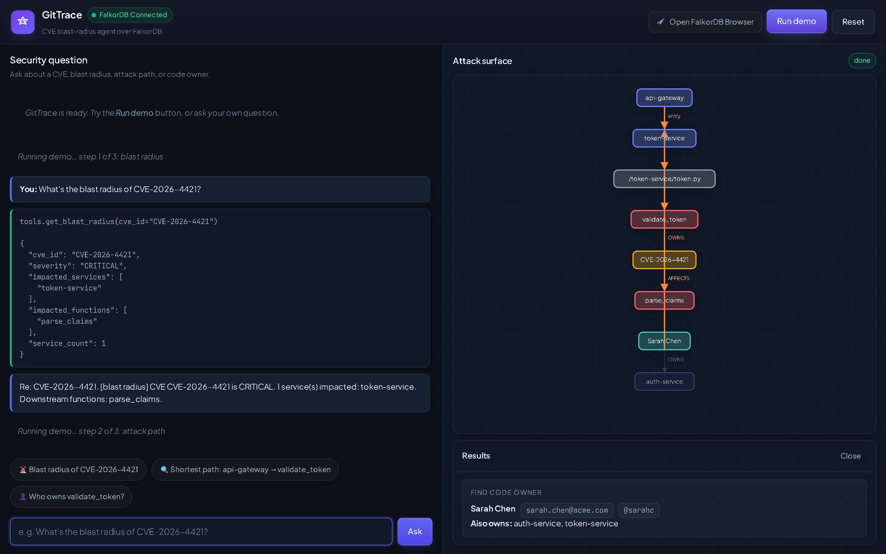
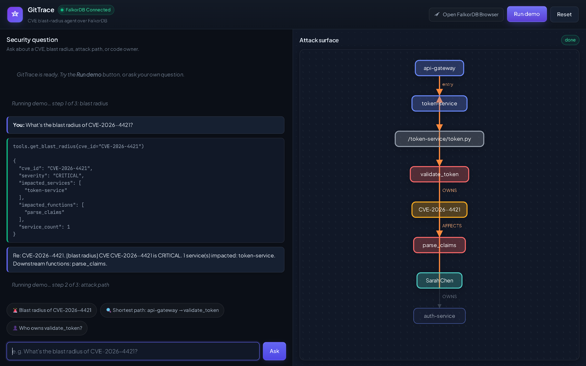
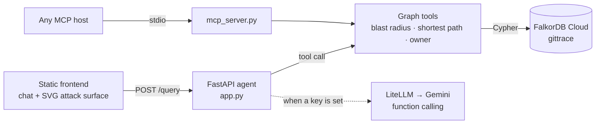

# GitTrace

**Turn a CVE alert into the blast radius, the shortest attack path, and the code owner — by traversing a service dependency graph in FalkorDB.**

[](https://github.com/codingwinterz/GitTrace/actions/workflows/tests.yml)


**Hackathon:** Graph Hacks — Track 01 (Agents That Act on Connected Data) · **Team:** SUDO SAIYAN (Avaneesh S, solo) · Team code `5S3M9E`
**Demo video:** [GIT TRACE's Working & Explanation](https://youtu.be/xwo16Zesdus) (3 min)

[](https://youtu.be/xwo16Zesdus)

---

## The question it answers

A scanner reports `CVE-2026-4421` in `validate_token`. Three things decide what you do next:

1. **What is in the blast radius?** Which services and downstream functions are reachable from the vulnerable code?
2. **How does an attacker actually get there?** Which public entry point reaches it, and through what path?
3. **Who do you wake up?** Who owns the affected code?

GitTrace answers all three from one graph, and returns the query that produced each answer.

## See it work





Tested against the seeded graph — the exact JSON from `GET /demo`:

| Question | Answer returned |
|---|---|
| Blast radius of `CVE-2026-4421` | `CRITICAL`, 1 service (`token-service`), downstream function `parse_claims` |
| Shortest path `api-gateway` → `validate_token` | `api-gateway → token-service → token-service/token.py → validate_token`, **3 hops** |
| Owner of `validate_token` | Sarah Chen · `sarah.chen@acme.com` · `@sarahc` (also owns `auth-service`, `token-service`) |

---

## Why FalkorDB is load-bearing

The answer *is* a path and a neighbourhood. A vector index can say which code chunks are semantically close to "authentication token"; it has no notion of an edge, so it cannot say that `validate_token` is three hops from a public gateway, or which functions a `CALLS` chain reaches.

Two native capabilities do all the work:

- **Variable-length traversal** — `(f)-[:CALLS*1..5]->(downstream)` walks the call graph to whatever depth the bug actually propagates.
- **`shortestPath()`** — resolves the exact route across five different relationship types (`CONTAINS`, `DEFINES`, `CALLS`, `DEPENDS_ON`, `EXPOSES`) in a single query.

Remove FalkorDB and the product still starts, but it can no longer answer any of the three questions — which is the test for "graph is essential" rather than decoration.

## Architecture



Two execution paths, same tools:

1. **LLM function calling** — Gemini picks a tool, the backend runs the Cypher, the model writes the answer.
2. **Deterministic classifier** — if no key is configured or the model fails, keyword heuristics call the same tools. The demo works either way; only the prose changes.

---

## Quick start

```bash
git clone https://github.com/codingwinterz/GitTrace && cd GitTrace
cp .env.example .env          # fill in FalkorDB host/port/user/password
python -m venv .venv && source .venv/bin/activate   # Windows: .venv\Scripts\activate
pip install -r requirements.txt
python seed_graph.py          # one-time: create the gittrace graph
python app.py                 # API on http://localhost:8000
python -m http.server 5500 --directory frontend     # UI on http://localhost:5500
```

Open `http://localhost:5500` and press **Run demo**. The Gemini key is optional — without it the classifier path answers instead.

### Environment

| Variable | Required | Purpose |
|---|---|---|
| `FALKORDB_HOST` / `FALKORDB_PORT` | yes | Cloud instance from **Connectivity → Connect** |
| `FALKORDB_USER` / `FALKORDB_PASSWORD` | yes | Instance credentials |
| `Gemini_API_Key` | no | Enables the LLM function-calling path |
| `LITELLM_MODEL` | no | Defaults to `gemini/gemini-flash-lite-latest` |
| `GITTRACE_PORT` | no | Backend port (default `8000`) |
| `GITTRACE_FRONTEND_ORIGIN` | no | Extra CORS origin for a deployed frontend |

`.env` is gitignored. The **Open FalkorDB Browser** button deep-links to the hosted graph tab; the URL is the `BROWSER_URL` constant in `frontend/app.js`.

---

## Graph data model

The seeded graph is a small but complete microservice estate: **7 services, 7 files, 22 functions, 4 developers, 2 CVEs, 5 API endpoints, 73 edges**.

| Node | Properties |
|---|---|
| `(:Service)` | `name, language, port, is_public` |
| `(:File)` | `path` |
| `(:Function)` | `name, line_number, is_entry_point` |
| `(:Developer)` | `name, email, slack_handle` |
| `(:CVE)` | `id, severity, description` |
| `(:APIEndpoint)` | `path, method` |

| Edge | From → To | Meaning |
|---|---|---|
| `CONTAINS` | Service → File | Service ships this file |
| `DEFINES` | File → Function | File defines this function |
| `CALLS` | Function → Function | Function calls another function |
| `DEPENDS_ON` | Service → Service | Service calls another service |
| `OWNS` | Developer → Service | Developer owns this service |
| `AUTHORED` | Developer → File | Developer wrote this file |
| `AFFECTS` | CVE → Function | CVE affects this function |
| `EXPOSES` | APIEndpoint → Function | Endpoint reaches this function |

## The three tools

### Blast radius — `get_blast_radius(cve_id)`

```cypher
MATCH path = (c:CVE {id: $cve_id})-[:AFFECTS]->(f:Function)
OPTIONAL MATCH affected = (f)-[:CALLS*1..5]->(downstream:Function)
OPTIONAL MATCH downstream_service = (downstream)<-[:DEFINES]-(f2:File)<-[:CONTAINS]-(s:Service)
RETURN
    c.id AS cve_id,
    c.severity AS severity,
    collect(DISTINCT s.name) AS impacted_services,
    collect(DISTINCT downstream.name) AS impacted_functions,
    count(DISTINCT s) AS service_count
```

### Shortest attack path — `find_shortest_dependency_path(start_service, target_function, *, cve_id=None, target_file_path=None)`

```cypher
MATCH (c:CVE {id: $cve_id})-[:AFFECTS]->(f:Function)
MATCH (s:Service {name: $start_service, is_public: true})
WITH s, f, shortestPath((s)-[:CONTAINS|DEFINES|DEPENDS_ON*1..10]->(f)) AS p
RETURN
    [n IN nodes(p) | labels(n)[0] + ':' + coalesce(n.name, n.path, n.id)] AS path_trace,
    length(p) AS hop_count
ORDER BY hop_count ASC, path_trace ASC
LIMIT 1
```

### Code owner — `find_code_owner(function_name)`

```cypher
MATCH (f:Function {name: $function_name})<-[:DEFINES]-(file:File)<-[:AUTHORED]-(dev:Developer)
OPTIONAL MATCH (dev)-[:OWNS]->(s:Service)
RETURN
    dev.name AS developer_name,
    dev.email AS email,
    dev.slack_handle AS slack,
    collect(DISTINCT s.name) AS owned_services
LIMIT 1
```

`/tools` returns the same three as OpenAI-format schemas, so any model can call them.

## API

| Method | Path | Description |
|---|---|---|
| `GET` | `/` | Root check — `{"status":"ok","app":"GitTrace"}` |
| `GET` | `/health` | Health check |
| `POST` | `/query` | Natural-language question → answer + tool calls |
| `GET` | `/tools` | Tool schemas |
| `GET` | `/demo` | Scripted three-question scenario, one JSON payload |

`POST /query` rejects missing, empty, or whitespace-only questions with `400` and a readable `detail`.

## MCP server (Track 01)

```bash
python mcp_server.py      # stdio transport
```

```json
{ "command": "python", "args": ["mcp_server.py"] }
```

Exposes `get_blast_radius_tool`, `find_shortest_dependency_path_tool`, `find_code_owner_tool` over the Model Context Protocol, so Claude Desktop or any MCP host can query the same graph.

---

## Tests

```bash
python -m pytest test_app.py -q        # 53 passed — no DB, no API key
python -m pytest test_integration.py -q  # 8 live tests — needs FalkorDB + Gemini
```

The offline suite covers helpers, all three graph tools against a mocked FalkorDB layer, the agent loop against a mocked LLM, and every FastAPI endpoint. It runs on a clean clone before `.env` exists, and in CI on Python 3.11–3.13 (`.github/workflows/tests.yml`). The live suite skips itself when FalkorDB is unreachable.

## Design decisions worth knowing

- **CVE-scoped disambiguation.** `validate_token` exists in both `auth-service` and `token-service`; matching by name alone can resolve the wrong instance. Path queries accept `cve_id` (resolve the target through `AFFECTS`) or `target_file_path`, so the path and the blast radius always point at the same node.
- **Native `shortestPath` instead of application-side BFS** — the graph engine does the traversal, so the code only formats the result.
- **Deterministic fallback** — a dead API key or exhausted quota degrades the prose, not the product.

## Track 01 and the submission rules

| Requirement | Where |
|---|---|
| Public repo + README with setup and graph model | this file |
| Cypher queries the product depends on | [The three tools](#the-three-tools) |
| Demo video | [YouTube, 3 min](https://youtu.be/xwo16Zesdus) |
| Live deployment **or** complete local setup | [Quick start](#quick-start) — verified end to end |
| Track named | Track 01 — Agents That Act on Connected Data |
| FalkorDB is primary and essential | [Why FalkorDB is load-bearing](#why-falkordb-is-load-bearing) |
| MCP / GraphRAG-SDK used | [MCP server](#mcp-server-track-01) |
| AI assistance disclosed | below |

## Limitations

- **Seed data is synthetic.** The graph models a representative microservice estate; it is not trained or evaluated on a real organisation's codebase.
- **The LLM is optional, not required.** With a valid Gemini key the agent chooses tools via function calling; without one, the keyword classifier picks them. Same tools, less flexible phrasing.
- **No public deployment.** Rule 10 accepts complete local setup, and that is what is documented and verified here.
- **The frontend is a single-page demo**, not a hardened multi-tenant product: no auth, no persistence, no rate limiting.

## AI assistance disclosure (Rule 11)

This project was built with AI coding assistance. An AI coding agent (Codebuff) wrote and edited code, tests, and documentation in this repository under the author's direction; the author ran the application, verified the graph queries against the live FalkorDB instance, and validated the outputs quoted in this README. No result in this document is a model claim — each one was produced by executing the code in this repo.

## License

MIT — see [LICENSE](LICENSE).
